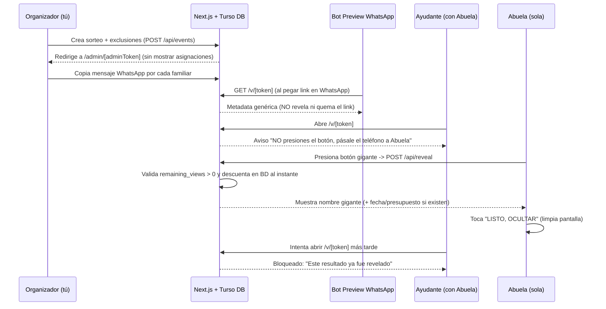

# Plan de Implementación: Amigo Secreto Familiar (Vercel + Turso)

> **Estado general:** Implementado y verificado en local (listo para desplegar en Vercel + Turso)  
> **Stack:** Next.js (App Router + TypeScript + Tailwind CSS) · Drizzle ORM · Turso (SQLite) · Vercel (Hobby)

---

## Seguimiento de Avance (Checklist)

### Fase 1 — Configuración Base y Base de Datos
- [x] Inicializar proyecto Next.js + Tailwind CSS + TypeScript (`package.json`)
- [x] Configurar `.env.example` y `drizzle.config.ts` (SQLite local `file:local.db` / Turso en producción)
- [x] Definir esquema de BD en `src/db/schema.ts` (`events`, `participants`, `exclusions`)
- [x] Crear cliente de BD en `src/db/index.ts`

### Fase 2 — Lógica de Sorteo y Seguridad
- [x] Implementar algoritmo de sorteo con exclusiones en `src/lib/draw.ts`
- [x] Implementar generación de tokens opacos en `src/lib/tokens.ts`

### Fase 3 — Endpoints API
- [x] `POST /api/events` (`src/app/api/events/route.ts`)
- [x] `GET /api/admin/[adminToken]` (`src/app/api/admin/[adminToken]/route.ts`) — proyección sin spoilers
- [x] `POST /api/admin/[adminToken]/grant-view` (`src/app/api/admin/[adminToken]/grant-view/route.ts`)
- [x] `POST /api/reveal/[token]` (`src/app/api/reveal/[token]/route.ts`) — consumo atómico

### Fase 4 — Interfaz de Usuario
- [x] Layout global y metadata OpenGraph segura para WhatsApp (`src/app/layout.tsx`, `src/app/globals.css`)
- [x] Pantalla 1: Creación de evento (`src/app/page.tsx`, `src/components/CreateEventForm.tsx`)
- [x] Pantalla 2: Panel del organizador (`src/app/admin/[adminToken]/page.tsx`, `src/components/AdminDashboard.tsx`)
- [x] Pantalla 3: Vista del participante y Modo Asistido / Abuela (`src/app/v/[token]/page.tsx`, `src/components/RevealCard.tsx`)

### Fase 5 — Pruebas y Despliegue
- [x] Tests unitarios del sorteo (`src/lib/draw.test.ts`)
- [x] Tests de integración de BD/revelado (`src/lib/reveal.test.ts`)
- [x] Verificación de tipos (`npx tsc --noEmit`) y build (`npm run build`)
- [x] Documentación de despliegue local y Vercel + Turso (`README.md`)
- [x] Prueba E2E local completa (flujo Abuela, protección GET WhatsApp, panel admin sin spoilers)

---

## Descripción del Objetivo

Construir una aplicación web minimalista y gratuita para organizar un **Amigo Secreto familiar** con las siguientes garantías:
1. **Privacidad total del organizador:** Aunque tú organices y también juegues como un participante más, el sistema **nunca** expone a quién le tocó a quién en el panel de administración ni en las URLs.
2. **Protección "Caso Abuela" (Modo Asistido):** Quienes ayuden a tu abuela a abrir el link verán una advertencia previa clara (*"Pásale el teléfono antes de tocar"*), un botón gigante de alto contraste, resultado en tipografía extra grande y un botón `"LISTO, OCULTAR"` que limpia la pantalla. El enlace queda **bloqueado en servidor** en el instante en que se revela el nombre.
3. **Protección contra vista previa de WhatsApp:** Cuando pegues los enlaces en WhatsApp, los bots que generan la tarjetita previa hacen peticiones `GET` a la URL. El `GET` inicial nunca revelará ni consumirá la vista; solo una acción explícita (`POST`) desde el botón del usuario revela y quema el enlace.
4. **Exclusiones y campos opcionales:** Soporte para exclusiones (por ejemplo, parejas), mostrando únicamente **el nombre del amigo secreto** más **fecha** y **presupuesto** solo si fueron definidos.
5. **Despliegue 100% gratuito:** **Next.js (App Router)** en **Vercel (Hobby)** conectado a **Turso (SQLite en la nube)** vía **Drizzle ORM**, funcionando en tu PC con un archivo SQLite local (`file:local.db`) para pruebas inmediatas.

---

## Decisiones de Diseño

- **Regla de ciclos (`A ↔ B`):** Se utilizará una permutación aleatoria válida (equivalente a sacar papelitos de una bolsa) respetando no auto-asignarse y las exclusiones configuradas. Como en el sorteo físico, dos personas podrían tocarse mutuamente por azar si el grupo lo permite.
- **Organizador como participante:** Tu nombre va en la lista como un participante normal, con tu propio enlace de un solo uso copiable desde el panel de administrador.

---

## Arquitectura y Flujo Principal

---

## Arquitectura de Archivos Planeados

### 1. Configuración Base y Base de Datos
- `package.json`: `next`, `react`, `react-dom`, `lucide-react`, `drizzle-orm`, `@libsql/client`, `typescript`, `tailwindcss`, `drizzle-kit`, `vitest`.
- `.env.example`: `TURSO_DATABASE_URL="file:local.db"` y `TURSO_AUTH_TOKEN=""`.
- `drizzle.config.ts`: Configuración de Drizzle Kit apuntando a `src/db/schema.ts`.
- `src/db/schema.ts`:
  - `events`: `id`, `adminToken`, `title`, `organizerName` *(opcional)*, `eventDate` *(opcional)*, `budget` *(opcional)*, `createdAt`.
  - `participants`: `id`, `eventId`, `name`, `token`, `targetId`, `isAssisted`, `remainingViews` (default `1`), `viewedAt`.
  - `exclusions`: `id`, `eventId`, `giverId`, `excludedId`.
- `src/db/index.ts`: Cliente singleton de `@libsql/client` + `drizzle`.

### 2. Lógica de Sorteo y Utilidades
- `src/lib/draw.ts`: `generateSecretSantaAssignments(participantIds, exclusions)` usando backtracking con heurística MRV + Fisher-Yates para garantizar permutación válida al azar o error claro si las exclusiones hacen imposible el sorteo.
- `src/lib/tokens.ts`: Generación de tokens aleatorios con `crypto.randomBytes(16).toString('base64url')`.

### 3. Endpoints API
- `src/app/api/events/route.ts` (`POST`): Valida inputs y factibilidad del sorteo, guarda evento, participantes y exclusiones en una transacción, y devuelve únicamente `{ adminToken }`.
- `src/app/api/admin/[adminToken]/route.ts` (`GET`): Consulta proyección estricta sin `targetId` (`id`, `name`, `token`, `isAssisted`, `remainingViews`, `viewedAt`).
- `src/app/api/admin/[adminToken]/grant-view/route.ts` (`POST`): Incrementa `remainingViews` en `+1` para un participante del evento sin revelar su resultado.
- `src/app/api/reveal/[token]/route.ts` (`POST`): Actualización atómica `WHERE token = ? AND remaining_views > 0` que descuenta 1 vista, registra `viewed_at` y devuelve `{ targetName, eventTitle, eventDate, budget }`.

### 4. Interfaz de Usuario
- `src/app/layout.tsx` y `src/app/globals.css`: Metadata OpenGraph genérica (*"Amigo Secreto Familiar 🎁"*) y estilos mobile-first.
- `src/app/page.tsx` + `src/components/CreateEventForm.tsx`: Formulario de creación con participantes, toggle `Modo asistido` y exclusiones opcionales (con opción "Mutuo").
- `src/app/admin/[adminToken]/page.tsx` + `src/components/AdminDashboard.tsx`: Panel cero spoilers con estados, copia de invitación WhatsApp y botón `Dar 1 vista más`.
- `src/app/v/[token]/page.tsx` + `src/components/RevealCard.tsx`:
  - `GET` nunca consulta `targetId`.
  - Estado 1 (Bienvenida / Advertencia para ayudante en `Modo asistido`).
  - Estado 2 (Nombre en grande + fecha/presupuesto si existen + botón `LISTO, OCULTAR`).
  - Estado 3 (Bloqueado cuando `remainingViews === 0`).

### 5. Pruebas y Documentación
- `src/lib/draw.test.ts`
- `src/lib/reveal.test.ts`
- `README.md`

---

## Plan de Verificación

### Pruebas Automatizadas
- `npx vitest run`
- `npx tsc --noEmit`
- `npm run build`

### Verificación Manual
1. Levantar `npm run dev` en `http://localhost:3000`.
2. Crear evento de prueba con tu nombre, tu abuela (`Modo asistido`) y otros 2 familiares, más una exclusión, dejando Fecha o Presupuesto vacío para confirmar que el campo vacío no aparezca.
3. Simular el bot de WhatsApp haciendo `GET` al link de tu abuela y comprobar que el HTML no contiene el nombre sorteado ni consume la vista.
4. Probar el flujo completo de tu abuela: advertencia previa → `VER A QUIÉN ME TOCÓ` → `LISTO, OCULTAR` → recargar y confirmar bloqueo → reactivar desde `/admin/[adminToken]` con `Dar 1 vista más`.
